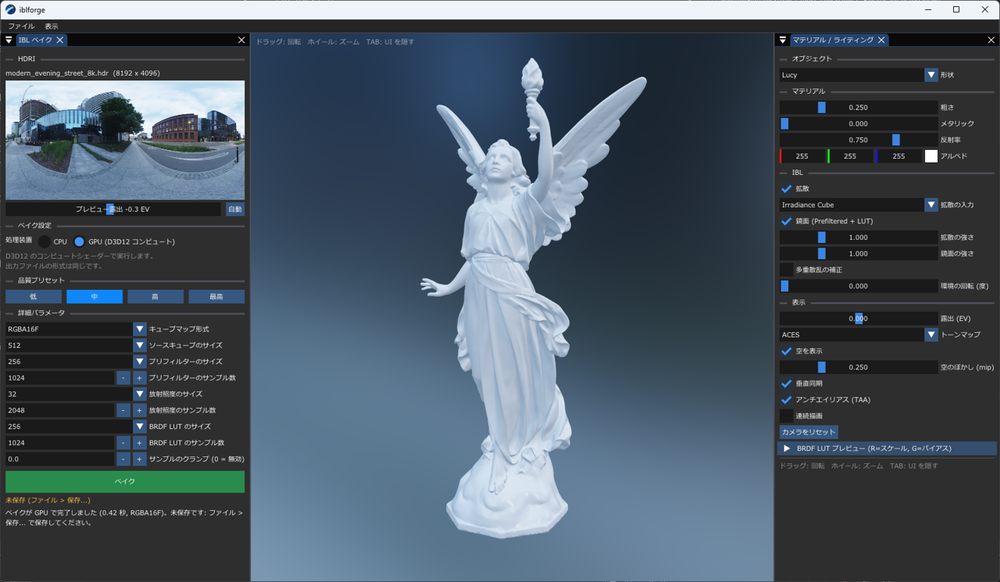

[English](README.md) | [日本語](README.ja.md)

# iblforge

**CPU・GPUアクセラレーションに対応したリアルタイムImage-Based Lighting（IBL）ベイキングツール。**

iblforgeは、正距円筒図法のHDR環境マップから、PBR向けのライティングテクスチャを生成するツールです。マルチスレッドCPU処理とDirect3D 12によるGPUアクセラレーションに対応した、柔軟なIBLベイキングパイプラインを提供します。ベイキングから結果の確認、エクスポートまで、すべてを1つのアプリケーションで行えます。

## 主な機能

- **スペキュラIBL** — GGXプリフィルタリングによる、完全なMipmapチェーンを持つ環境キューブマップを生成。
- **ディフューズIBL** — コサイン重み付き半球サンプリングによるイラディアンスキューブマップを生成。
- **BRDF積分** — Split-Sum近似に使用するBRDF積分LUTを生成。
- **CPU・GPUアクセラレーション** — マルチスレッドCPU処理とDirect3D 12コンピュートシェーダーを選択可能。
- **柔軟なベイキング設定** — テクスチャ解像度、サンプリング数、Firefly Clampingを調整可能。
- **複数の出力フォーマット** — HDRキューブマップをRGBA16F、RGBA32F、R11G11B10F、BC6Hでエクスポート。
- **コマンドラインインターフェース** — GUIを起動せずにベイキングとエクスポートが可能。
- **3Dプレビュー** — マテリアルやライティングパラメータを調整しながら、3Dモデル上で生成したライティングテクスチャを確認可能。

## 生成されるテクスチャ

iblforgeは、1枚の正距円筒図法HDR環境マップから、以下の3種類のDDSテクスチャと、球面調和関数 (SH) の係数ファイルを生成します。

| 出力ファイル | 説明 | デフォルトフォーマット |
|---|---|---|
| `*_prefiltered.dds` | 完全なMipmapチェーンを持つGGXプリフィルタリング済みスペキュラ環境キューブマップ | RGBA16F |
| `*_irradiance.dds` | コサイン重み付き畳み込みによって生成されるディフューズイラディアンスキューブマップ | RGBA16F |
| `*_sh.json` | ディフューズイラディアンスのSH (L2) 係数 (RGB 9組) と、HDRIを射影しただけの放射輝度の係数 | JSON |
| `*_brdf_lut.dds` | Split-Sum近似用BRDF積分ルックアップテクスチャ | RG16F |

### プリフィルタリング済みスペキュラキューブマップ

GGX Importance Samplingを使用して生成されます。各Mipmapレベルは異なる表面粗さに対応しており、PBRシェーダーで効率的にスペキュラIBLを近似できます。

粗さからMipmapレベルへの変換は次のとおりです。

```cpp
float mipLevel = roughness * (mipCount - 1);
```

### ディフューズイラディアンスキューブマップ

コサイン重み付き半球サンプリングを使用して生成されます。出力にはπで正規化されたイラディアンスが格納されるため、ディフューズライティングは次のように計算できます。

```hlsl
float3 diffuse = albedo * irradiance;
```

### SH係数 (`*_sh.json`)

HDRIをL2の球面調和関数 (RGB 9係数) に直接射影します (立体角で重み付け。サンプルクランプはベイク設定と同じ)。ファイルには2つの配列が入っています。

- `irradiance_over_pi` — コサイン畳み込み済みの係数。イラディアンスキューブマップ (イラディアンス / π) と同じ量です。
- `radiance` — HDRIを射影しただけの係数です。

基底の並び・定数・座標系 (左手系 / Y-up) はファイル内に書かれています。ディフューズライティングは次のように計算できます。

```hlsl
// Y[i]: 正規化した法線 N の実数SH基底 (ファイルに書かれた並び)
float3 diffuse = albedo * max(0, sum_i irradiance_over_pi[i] * Y[i](N));
```

L2のSHは本来なめらかなため、太陽のような鋭い光源はイラディアンスキューブマップよりぼやけます。3Dビューでは「拡散の入力」でイラディアンスキューブマップとSH係数を切り替えられます。SHは、ベイク後、または隣に `*_sh.json` があるファイルをインポートした後に選べます。

### BRDF積分LUT

イメージベースのスペキュラライティングに使用するSplit-Sum近似によって生成されます。2つのチャンネルには、スペキュラBRDFの評価に使用するScale項とBias項が格納されます。

```hlsl
float2 brdf = brdfLut.Sample(samplerState, float2(NdotV, roughness));

float3 specular = prefilteredColor * (F0 * brdf.x + brdf.y);
```

## スクリーンショット



アプリケーションはドッキング可能なインターフェースを採用しており、主に以下の3つのパネルで構成されています。

- **IBL Bake** — HDR環境マップのプレビューとベイキング設定。
- **3D View** — 選択したモデルのリアルタイムPBRプレビュー。
- **Material / Lighting** — マテリアル設定、ライティング調整、BRDF LUTの表示。

## はじめに

### 動作環境

- Windows 10以降
- Visual Studio 2022以降
- CMake 3.21以降
- Direct3D 12対応GPU（GPUベイキングおよび3Dプレビューに必要）

### ビルド方法

リポジトリをクローンします。

```bash
git clone https://github.com/esu0108/iblforge.git
cd iblforge
```

プロジェクトを構成します。

```bash
cmake -S . -B build -G "Visual Studio 17 2022" -A x64
```

ビルドします。

```bash
cmake --build build --config Release
```

必要な依存ライブラリは、CMake FetchContentによって自動的にダウンロードされます。また、サンプル3Dモデルのダウンロードと変換も、構成およびビルド時に自動的に実行されます。

実行ファイルは以下の場所に生成されます。

```text
build/Release/iblforge.exe
```

### GUIの使い方

アプリケーションを起動します。

```bash
iblforge.exe
```

1. `File > Open HDRI...` からHDR環境マップを開くか、`.hdr` / `.exr` ファイルをウィンドウにドラッグ＆ドロップします。
2. **IBL Bake** パネルでベイキングパラメータを設定します。
3. CPUまたはGPUの処理方式を選択します。
4. **Bake** をクリックしてライティングテクスチャを生成します。
5. 3Dビューアで生成結果を確認します。
6. `File > Save baked textures...` からテクスチャをエクスポートします。

ベイキングしたテクスチャは、明示的に保存するまでメモリ上に保持されます。

以前生成したテクスチャは、`File > Import baked textures...` から読み込めます。3種類のDDSファイルのうち、いずれか1つを選択すると、残りの2つも自動的に検出されます (`*_sh.json` があれば、それも読み込まれます)。

### コマンドラインの使い方

iblforgeはヘッドレスベイキングに対応しており、GUIを起動せずにコマンドラインから直接テクスチャを生成・エクスポートできます。

```bash
iblforge.exe --bake-only input.hdr output_directory
```

使用例：

```bash
iblforge.exe --bake-only environment.hdr output --size 256 --samples 2048
```

#### コマンドラインオプション

| オプション | 説明 | デフォルト |
|---|---|---|
| `--bake-only` | GUIを起動せず、直接ベイキングと保存を実行 | 無効 |
| `--cpu` | CPUによるベイキングを使用 | GPU |
| `--gpu` | Direct3D 12コンピュートシェーダーを使用 | GPU |
| `--src N` | 入力キューブマップの解像度 | 512 |
| `--size N` | プリフィルタリング済みキューブマップの解像度 | 256 |
| `--samples N` | スペキュラプリフィルタリングのサンプリング数 | 1024 |
| `--lut N` | BRDF LUTの解像度 | 256 |
| `--lut-samples N` | BRDF LUTのサンプリング数 | 1024 |
| `--irr N` | イラディアンスキューブマップの解像度 | 32 |
| `--irr-samples N` | イラディアンスのサンプリング数 | 2048 |
| `--clamp N` | サンプル値の最大値。0でクランプを無効化 | 0 |
| `--format FORMAT` | キューブマップの出力フォーマット | `f16` |
| `--out PATH` | 出力ディレクトリ | — |

対応する出力フォーマット：

- `f16` — RGBA16F
- `f32` — RGBA32F
- `r11g11b10` — R11G11B10F
- `bc6h` — BC6H

出力ディレクトリは、2番目の位置引数として指定することもできます。

## ベイキング

### CPU・GPU実装

iblforgeは、IBLベイキングパイプラインの2種類の実装を提供します。

**CPU**

- 利用可能なCPUコアを使用したマルチスレッド処理。
- GPUコンピュートが利用できない環境や、GPUの安定性に問題がある場合に適しています。

**GPU**

- Direct3D 12コンピュートシェーダーによる処理。
- 正距円筒図法からキューブマップへの変換、Mipmap生成、スペキュラプリフィルタリング、イラディアンス畳み込み、BRDF LUT生成をGPU上で実行。
- CPU実装と同じサンプリングテーブルを使用し、一貫した結果を実現。
- 重い処理を複数の小さなDispatch Batchに分割し、GPUタイムアウトのリスクを軽減。
- 非同期実行に対応し、アプリケーションの応答性を維持。

どちらの実装も同じ出力フォーマットとファイル命名規則に対応しています。なお、浮動小数点演算によるわずかな差異が発生する場合があります。

### 出力フォーマット

プリフィルタリング済みキューブマップとイラディアンスキューブマップは、以下の4種類のフォーマットに対応しています。

| フォーマット | DXGIフォーマット | RGBA32Fに対する相対サイズ | 説明 |
|---|---|---:|---|
| RGBA16F | R16G16B16A16_FLOAT | 1/2 | デフォルトの推奨フォーマット |
| RGBA32F | R32G32B32A32_FLOAT | 1 | フル精度 |
| R11G11B10F | R11G11B10_FLOAT | 1/4 | アルファチャンネルを持たないコンパクトなHDRフォーマット |
| BC6H | BC6H_UF16 | 1/16 | HDR圧縮フォーマット |

BRDF LUTは常にRG16Fでエクスポートされます。

BC6H圧縮は、マルチスレッド処理を使用してCPU上で実行されます。

## 3Dプレビュー

iblforgeには、生成したIBLテクスチャを確認するためのDirect3D 12ベースのPBRビューアが搭載されています。

### サンプルモデル

ビューアには以下のサンプルモデルが用意されています。

| モデル | 説明 |
|---|---|
| Stanford Bunny | デフォルトモデル |
| Armadillo | 細部まで作り込まれた有機的な形状 |
| Happy Buddha | 彫刻モデル |
| Lucy | 高精細なスキャンモデル |
| Sphere | 内蔵フォールバックモデル |

サンプルモデルは、[alecjacobson/common-3d-test-models](https://github.com/alecjacobson/common-3d-test-models) から、固定されたコミットを指定して取得されます。

### 操作方法

| 入力 | 操作 |
|---|---|
| マウス左ボタンのドラッグ | カメラの回転 |
| マウスホイール | ズーム |
| `TAB` | UIの表示・非表示を切り替え |
| `CTRL + O` | HDR環境マップを開く |
| `CTRL + S` | ベイキング済みテクスチャを保存 |
| `CTRL + I` | ベイキング済みテクスチャをインポート |

インターフェースにはDear ImGuiのDocking機能を使用しており、パネルの移動、分割、タブ化が可能です。

## 技術的な詳細

### 座標系

iblforgeは、Direct3Dと互換性のある左手系・Y-upの座標系を使用します。

正距円筒図法からの座標変換は次のとおりです。

```cpp
u = 0.5f + atan2(x, z) / (2.0f * PI);
v = acos(y) / PI;
```

環境マップの中央は、正のZ方向に対応します。

キューブマップの面の順序は、Direct3Dの`TextureCube`規約に従います。

```text
+X, -X, +Y, -Y, +Z, -Z
```

## 依存ライブラリ

iblforgeでは、以下のサードパーティライブラリを使用しています。

| ライブラリ | 用途 | バージョン |
|---|---|---|
| [DirectXTex](https://github.com/microsoft/DirectXTex) | HDR画像の読み込み、DDSテクスチャの入出力 | oct2025 |
| [TinyEXR](https://github.com/syoyo/tinyexr) | OpenEXR (.exr) 画像の読み込み | v3.4.0 |
| [Dear ImGui](https://github.com/ocornut/imgui) | GUIおよびDockingインターフェース | v1.93.0-docking |
| [rapidobj](https://github.com/guybrush77/rapidobj) | ビルド時のメッシュ変換ツールにおけるOBJ読み込み | v1.1 |
| [meshoptimizer](https://github.com/zeux/meshoptimizer) | ビルド時のメッシュ変換ツールにおけるメッシュ最適化 | v1.3 |

すべての依存ライブラリは、CMake FetchContentによって自動的にダウンロードされます。