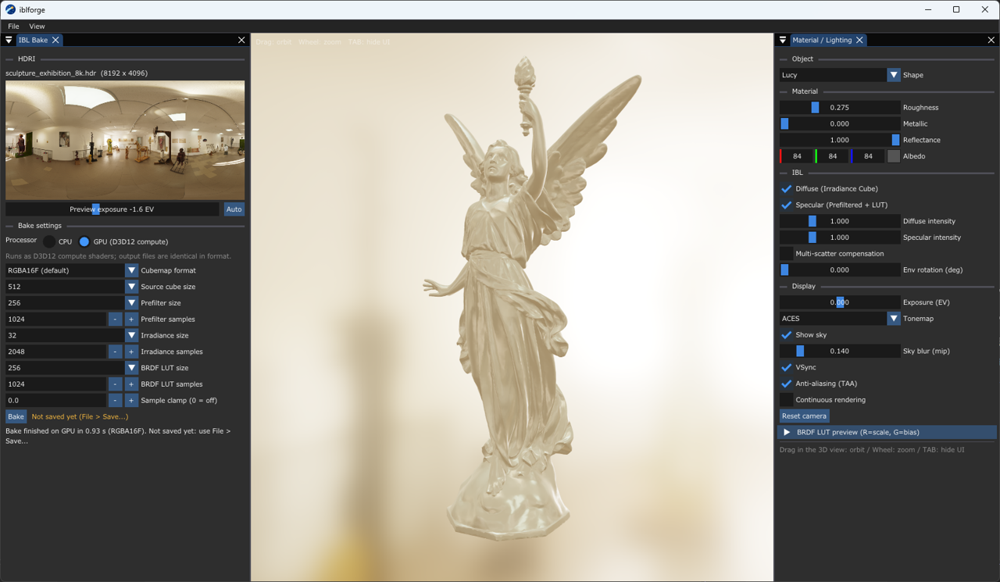

# iblforge

**A real-time Image-Based Lighting (IBL) baking tool with CPU and GPU acceleration.**

iblforge converts panoramic HDR environment maps into PBR-ready lighting textures. It combines a configurable IBL baker with a Direct3D 12 viewer, allowing you to bake, inspect, adjust, and export lighting data in one application.

## Features

- **Complete IBL baking** — Generate prefiltered specular cubemaps, diffuse irradiance cubemaps, and BRDF integration LUTs.
- **CPU & GPU acceleration** — Choose between a multithreaded CPU implementation and Direct3D 12 compute shaders.
- **Multilingual UI** — English, 日本語, 简体中文, 한국어, Español, Français, Deutsch, Русский. Switch from the **Language** menu (saved to `language.txt` next to the exe; defaults to the OS language). Add a language by editing `src/i18n/I18nStrings.inc` and `Lang` in `src/i18n/I18n.h`.
- **Real-time preview** — Inspect baked lighting on 3D models with adjustable materials and lighting parameters.
- **Multiple output formats** — Export HDR cubemaps in RGBA16F, RGBA32F, R11G11B10F, or BC6H.
- **Configurable baking** — Adjust texture resolutions, sampling counts, and firefly clamping.
- **Asynchronous processing** — Keep the interface responsive while loading HDR images and baking textures.
- **Headless mode** — Bake and export textures directly from the command line without opening the GUI.
- **TAA** — Temporal anti-aliasing for smoother real-time previews.

## Generated Textures

iblforge generates three DDS textures from a single equirectangular HDR environment map.

| Output | Description | Default Format |
|---|---|---|
| `*_prefiltered.dds` | GGX-prefiltered specular environment cubemap with a complete mip chain | RGBA16F |
| `*_irradiance.dds` | Diffuse irradiance cubemap using cosine-weighted convolution | RGBA16F |
| `*_brdf_lut.dds` | Split-sum BRDF integration lookup texture | RG16F |

### Prefiltered Specular Cubemap

<text>Generated using GGX importance sampling. Each mip level represents a different surface roughness, allowing PBR shaders to efficiently approximate specular image-based lighting.</text>

The roughness-to-mip mapping is:

```cpp
float mipLevel = roughness * (mipCount - 1);
```

### Diffuse Irradiance Cubemap

<text>Generated using cosine-weighted hemisphere sampling. The output stores irradiance divided by π, so the diffuse lighting calculation is:</text>

```hlsl
float3 diffuse = albedo * irradiance;
```

### BRDF Integration LUT

<text>Generated using split-sum approximation for image-based specular lighting. The two channels store the scale and bias terms used to evaluate the specular BRDF.</text>

```hlsl
float2 brdf = brdfLut.Sample(samplerState, float2(NdotV, roughness));

float3 specular = prefilteredColor * (F0 * brdf.x + brdf.y);
```

## Screenshots



The application provides a dockable interface with three main areas:

- **IBL Bake** — HDR environment preview and baking settings.
- **3D View** — Real-time rendering of the selected model.
- **Material / Lighting** — Material properties, lighting controls, and BRDF LUT inspection.

## Getting Started

### Requirements

- Windows 10 or later
- Visual Studio 2022 or later
- CMake 3.21 or later
- Direct3D 12-compatible GPU (for GPU baking and rendering)

### Build

Clone the repository:

```bash
git clone https://github.com/esu0108/iblforge.git
cd iblforge
```

Configure the project:

```bash
cmake -S . -B build -G "Visual Studio 17 2022" -A x64
```

Build:

```bash
cmake --build build --config Release
```

CMake automatically downloads the required dependencies using FetchContent. It also downloads and converts the sample 3D models during configuration and build.

The executable is generated in:

```text
build/Release/iblforge.exe
```

### GUI Usage

Launch the application:

```bash
iblforge.exe
```

1. Open an HDR environment map using `File > Open HDRI...` or drag and drop an `.hdr` file onto the window.
2. Configure the baking parameters in the **IBL Bake** panel.
3. Select CPU or GPU processing.
4. Click **Bake** to generate the lighting textures.
5. Inspect the results in the 3D viewer.
6. Export the textures using `File > Save baked textures...`.

Baked textures remain in memory until explicitly saved.

Previously generated textures can be loaded using `File > Import baked textures...`. Select any one of the three DDS files, and the other two are located automatically.

### Command Line

iblforge also supports command-line baking without opening the GUI.

```bash
iblforge.exe --bake-only input.hdr output_directory
```

Example:

```bash
iblforge.exe --bake-only environment.hdr output --size 256 --samples 2048
```

#### Command-line Options

| Option | Description | Default |
|---|---|---|
| `--bake-only` | Run without opening the GUI and save the results directly | Disabled |
| `--cpu` | Use CPU baking | GPU |
| `--gpu` | Use Direct3D 12 compute shaders | GPU |
| `--src N` | Source cubemap resolution | 512 |
| `--size N` | Prefiltered cubemap resolution | 256 |
| `--samples N` | Specular prefilter sampling count | 1024 |
| `--lut N` | BRDF LUT resolution | 256 |
| `--lut-samples N` | BRDF LUT sampling count | 1024 |
| `--irr N` | Irradiance cubemap resolution | 32 |
| `--irr-samples N` | Irradiance sampling count | 2048 |
| `--clamp N` | Maximum sample value; 0 disables clamping | 0 |
| `--format FORMAT` | Cubemap output format | `f16` |
| `--out PATH` | Output directory | — |

Supported output formats:

- `f16` — RGBA16F
- `f32` — RGBA32F
- `r11g11b10` — R11G11B10F
- `bc6h` — BC6H

The output directory can also be specified as the second positional argument.

## Baking Options

### CPU and GPU Processing

iblforge provides two baking implementations.

**CPU**

- Multithreaded processing.
- Parallel execution across available CPU cores.
- Useful when GPU compute is unavailable or GPU stability is a concern.

**GPU**

- Direct3D 12 compute shaders.
- Equirectangular-to-cubemap conversion, mip generation, specular prefiltering, irradiance convolution, and BRDF LUT generation run on the GPU.
- Uses the same sampling tables as the CPU implementation for consistent results.
- Splits heavy workloads into smaller dispatch bands to reduce the risk of GPU timeouts.
- Supports asynchronous execution while keeping the viewer responsive.

Both implementations produce the same output formats and file naming conventions. Minor floating-point differences are expected.

### Output Formats

The prefiltered and irradiance cubemaps support four formats.

| Format | DXGI Format | Relative Size vs. RGBA32F | Description |
|---|---|---:|---|
| RGBA16F | R16G16B16A16_FLOAT | 1/2 | Recommended default |
| RGBA32F | R32G32B32A32_FLOAT | 1 | Full precision |
| R11G11B10F | R11G11B10_FLOAT | 1/4 | Compact HDR format without alpha |
| BC6H | BC6H_UF16 | 1/16 | Compressed HDR format |

The BRDF LUT is always exported as RG16F.

BC6H compression is performed on the CPU using parallel processing.

### Canceling a Bake

Baking can be canceled at any time using the **Cancel** button.

The CPU and GPU implementations check for cancellation between processing batches. A canceled operation discards its partial result and preserves the previously completed bake.

## 3D Viewer

iblforge includes a Direct3D 12 PBR viewer for inspecting generated IBL textures.

### Sample Models

The viewer includes several sample models:

| Model | Description |
|---|---|
| Stanford Bunny | Default model |
| Armadillo | Detailed organic geometry |
| Happy Buddha | Sculpted geometry |
| Lucy | High-detail scanned model |
| Sphere | Built-in fallback model |

The sample models are downloaded from [alecjacobson/common-3d-test-models](https://github.com/alecjacobson/common-3d-test-models) at a pinned commit.

They are converted into an optimized binary mesh format during the build process.

### Interaction

| Input | Action |
|---|---|
| Left mouse drag | Orbit camera |
| Mouse wheel | Zoom |
| `TAB` | Toggle UI visibility |
| `CTRL + O` | Open HDR environment |
| `CTRL + S` | Save baked textures |
| `CTRL + I` | Import baked textures |

The interface uses Dear ImGui docking, allowing panels to be rearranged, split, and tabbed.

### Temporal Anti-Aliasing

The 3D viewer supports Temporal Anti-Aliasing (TAA).

- Halton(2,3) subpixel jitter.
- Motion-vector-based temporal reprojection.
- History clamping using the current frame's local color distribution.
- Adaptive blending based on pixel motion.

TAA can be enabled or disabled in the **Material / Lighting** panel.

### Event-Driven Rendering

The application uses an event-driven rendering loop instead of continuously rendering every frame.

Rendering is triggered by user input, window events, active baking, and other visual updates. When idle, the application waits for operating system messages, keeping CPU and GPU usage low.

Continuous rendering can be enabled for performance benchmarking.

## Technical Details

### Coordinate System

iblforge uses a left-handed, Y-up coordinate system compatible with Direct3D.

The equirectangular mapping is:

```cpp
u = 0.5f + atan2(x, z) / (2.0f * PI);
v = acos(y) / PI;
```

The center of the environment map corresponds to the positive Z direction.

Cubemap face order follows Direct3D's `TextureCube` convention:

```text
+X, -X, +Y, -Y, +Z, -Z
```

### Mesh Processing

Sample OBJ models are converted into an optimized binary `.mesh` format using the `meshforge` build tool.

The conversion pipeline includes:

1. OBJ loading and triangulation using rapidobj.
2. Smooth normal generation when normals are missing.
3. Vertex deduplication based on position and normal.
4. Model normalization.
5. Coordinate system conversion.
6. Vertex cache optimization.
7. Overdraw optimization.
8. Vertex fetch optimization.

The resulting mesh files are loaded directly into GPU buffers at runtime. OBJ parsing is not required by the main application.

## Dependencies

iblforge uses the following third-party libraries:

| Library | Purpose | Version |
|---|---|---|
| [DirectXTex](https://github.com/microsoft/DirectXTex) | HDR image loading and DDS texture I/O | oct2025 |
| [Dear ImGui](https://github.com/ocornut/imgui) | GUI and docking interface | v1.93.0-docking |
| [rapidobj](https://github.com/guybrush77/rapidobj) | OBJ loading for the build-time mesh converter | v1.1 |
| [meshoptimizer](https://github.com/zeux/meshoptimizer) | Mesh optimization for the build-time mesh converter | v1.3 |

Dependencies are downloaded automatically through CMake FetchContent.
